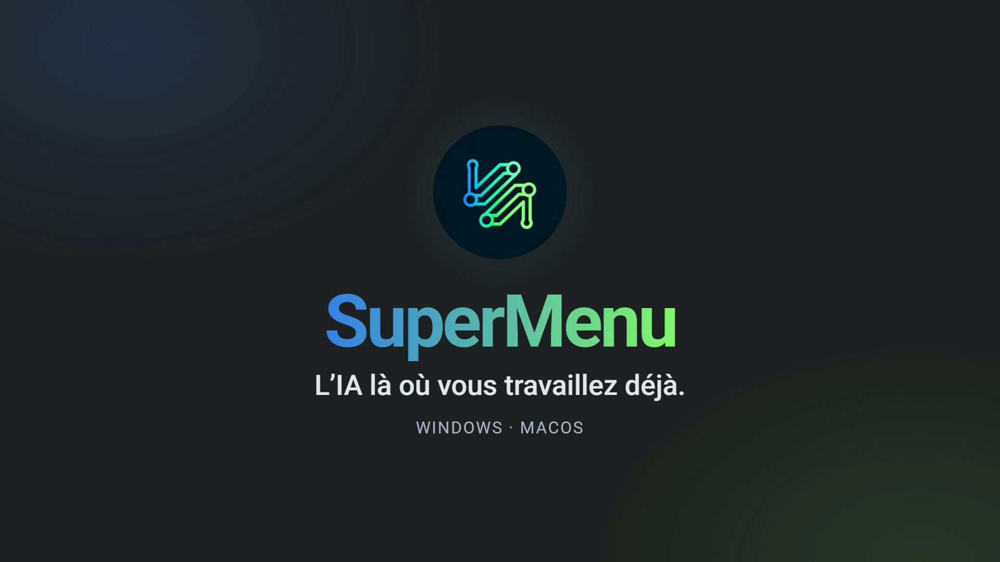

<p align="center">
  
</p>

<p align="center">
  <a href="https://github.com/lfpoulain/SuperMenu/actions/workflows/ci.yml"></a>
  <a href="https://github.com/lfpoulain/SuperMenu/releases/latest"></a>
  
  
  <a href="LICENSE"></a>
</p>

<p align="center">
  <strong>Français</strong> · <a href="README.en.md">English version</a>
</p>

**Sélectionnez du texte, appuyez sur un raccourci, choisissez une action : l’IA
corrige, reformule, résume ou traduit sans que vous quittiez votre application.**

SuperMenu est une application de bureau pour Windows et macOS. Elle se loge
dans la zone de notification ou la barre des menus et ouvre, d’un raccourci
clavier, un menu de prompts au-dessus de n’importe quelle application : mail,
navigateur, traitement de texte, éditeur de code… La réponse s’affiche dans une
petite fenêtre, prête à être copiée ou insérée à la place de votre sélection.

[Installation](#installation) · [Fonctionnalités](#fonctionnalités) ·
[Moteurs IA](#moteurs-ia) · [Raccourcis](#raccourcis-par-défaut) ·
[Confidentialité](#confidentialité-et-sécurité) · [Développement](#développement) ·
[Documentation](#documentation) · [Licence](#licence)

## Pourquoi SuperMenu

- **Fini les allers-retours vers une fenêtre de chat.** L’IA vient à votre
  texte, là où vous l’écrivez, puis vous rend la main.
- **Vos actions, vos raccourcis.** Une dizaine de prompts prêts à l’emploi,
  que vous pouvez modifier, compléter par les vôtres et réordonner.
- **Le moteur de votre choix.** OpenAI dans le cloud, ou un modèle local
  (Ollama, LM Studio, Foundry Local sous Windows, Apple Intelligence sous
  macOS) quand le texte ne doit pas quitter votre machine.
- **Simple par défaut.** Une nouvelle installation n’affiche que l’essentiel ;
  les fonctions avancées et expérimentales s’activent dans les réglages, quand
  vous en avez besoin.

## Comment ça marche

1. **Sélectionnez** du texte dans n’importe quelle application.
2. **Appuyez** sur `Ctrl+²` sous Windows ou `Cmd+Shift+Space` sous macOS : le
   menu des prompts s’ouvre près du curseur.
3. **Choisissez** une action. La réponse s’affiche avec **Copier**, **Insérer
   le texte** et **Réessayer**, ou s’insère directement dans l’application
   d’origine si le prompt est réglé ainsi.

L’interface de SuperMenu est en français.

## Fonctionnalités

> [!NOTE]
> Ce README décrit la branche `main`, publiée d’abord dans la Bêta. Les
> nouveautés qui ne sont pas encore dans une release Stable sont listées dans
> la section « Non publié » du [journal des modifications](CHANGELOG.md).

Tout se règle dans la fenêtre de configuration, ouverte depuis l’icône de
SuperMenu : onglets **Prompts**, **Voix**, **Réglages** et **À propos**, et
dans **Réglages**, les rubriques **Texte**, **Dictée**, **Raccourcis** et
**Application**. L’onglet **Voix** et la rubrique **Dictée** n’apparaissent
qu’avec les fonctions expérimentales.

### Essentiel — toujours disponible

- **Menu de prompts par raccourci global**, utilisable dans toutes vos
  applications.
- **Prompts prêts à l’emploi** : corriger, reformuler, résumer, expliquer,
  développer, extraire les passages importants, générer une réponse, trouver
  les actions à faire, traduire en anglais ou en français…
- **Vos propres prompts** : création, modification, réordonnancement, import
  et export. **Tout restaurer…** revient aux prompts d’origine et
  **Revenir à la copie…** rétablit une version précédente de votre
  bibliothèque ; chaque nouvel usage remonte d’une copie, parmi les cinq
  conservées.
- **Mode personnalisé** (`Ctrl+Alt+M` / `Cmd+Shift+M`) pour écrire une
  instruction libre, avec ou sans texte sélectionné.
- **Fenêtre de réponse** : **Copier**, **Insérer le texte**, **Réessayer** et
  **Voir le raisonnement** quand le modèle en fournit un.
- **Insertion directe** : un prompt peut insérer son résultat sans ouvrir la
  fenêtre de réponse.
- **Raisonnement réglable pour chaque prompt** (réglage du moteur, sans ou avec
  raisonnement), quand le modèle le permet.
- **Tous les moteurs de texte** de la plateforme, choisis dans
  **Réglages > Texte** (voir [Moteurs IA](#moteurs-ia)).
- **Thèmes** sombre (par défaut), clair ou automatique.
- **Mises à jour intégrées**, canal Stable ou Bêta.

### Fonctions avancées

Pour choisir finement quel modèle traite quoi.

- **Un modèle par prompt** : pour chaque prompt, texte ou vocal, le moteur
  (OpenAI, serveur Ollama ou LM Studio configuré, Foundry Local sous Windows ou
  Apple Intelligence sous macOS), le modèle et, avec LM Studio, le poste LM Link
  qui l’exécute. Copies locales et copies LM Link d’un même modèle sont
  distinguées.
- **Un raccourci direct par prompt**, pour lancer une action sans ouvrir le
  menu.
- **Durée de conservation des modèles locaux en mémoire** : après chaque
  utilisation, après 1, 5, 15 ou 30 minutes d’inactivité, ou jusqu’à la
  fermeture de SuperMenu. Sous Windows, elle concerne le modèle de texte et le
  modèle vocal de Foundry Local ; sous macOS, le modèle vocal Apple Speech.

Sans les fonctions avancées, chaque prompt utilise le moteur et le modèle de
**Réglages > Texte**, les raccourcis par prompt sont libérés et les modèles
locaux sont déchargés après 5 minutes d’inactivité.

### Fonctions expérimentales

Pour la voix et, sous Windows, l’écran. Ces fonctions peuvent encore évoluer.

- **Prompts vocaux** (onglet **Voix**) : vous dictez votre demande, SuperMenu
  la transcrit et l’envoie avec l’instruction du prompt et, si vous le
  souhaitez, avec le texte sélectionné. Sous Windows, `Ctrl+Alt+²` ouvre le
  menu vocal ; sous macOS, ce menu est le sous-menu **Voix** du menu des
  prompts.
- **Dictée en direct** (**Dicter du texte…** dans le menu vocal, et aussi dans
  la barre des menus sous macOS) : le texte apparaît pendant que vous parlez,
  avec le niveau du micro, pendant cinq minutes au plus. Il peut ensuite être
  copié ou inséré, collé automatiquement et, au choix, corrigé par le moteur de
  texte avant l’insertion.
- **Dictée instantanée** : un raccourci, à définir dans
  **Réglages > Raccourcis**, lance la dictée depuis l’application où vous
  écrivez. Appuyez une fois, ou maintenez la touche pour parler.
- **Rubrique Réglages > Dictée** : moteur de transcription, microphone, langues
  et vocabulaire, et un **test du micro** de 5 secondes, sans enregistrement ni
  envoi audio.
- **Capture et analyse d’écran** (Windows uniquement, `Ctrl+Alt+&`) : plein
  écran, zone choisie, ou choix du mode à chaque capture (**Demander à chaque
  capture**). L’analyse demande un modèle
  capable de lire les images ; Foundry Local ne les prend pas en charge.

### Activer ou désactiver ces fonctions

Les deux interrupteurs **Fonctions avancées** et **Fonctions expérimentales**
sont indépendants. Ils se trouvent dans **Réglages > Application > Fonctions**
et s’appliquent avec **Appliquer**, sans redémarrer.

| Situation | Fonctions avancées | Fonctions expérimentales |
|---|---|---|
| Nouvelle installation | désactivées | désactivées |
| Mise à jour depuis une version précédente | activées | activées |

Désactiver une fonction la masque et la met hors service, **sans rien
supprimer** : prompts, raccourcis et réglages réapparaissent tels quels quand
vous la réactivez. Si des prompts ont leur propre modèle, SuperMenu demande
confirmation avant de couper les fonctions avancées, car ces prompts passeront
alors par le moteur de **Réglages > Texte**, qui peut être un service en ligne.

## Moteurs IA

### Texte

| Moteur | Où tourne le modèle | Windows | macOS | Ce qu’il faut |
|---|---|:---:|:---:|---|
| **OpenAI** | cloud OpenAI | ✅ | ✅ | une clé API OpenAI (facturation à l’usage) |
| **Ollama** | votre machine ou le serveur indiqué | ✅ | ✅ | un serveur Ollama accessible |
| **LM Studio**, y compris **LM Link** | votre machine, le serveur indiqué ou un poste relié par LM Link | ✅ | ✅ | un serveur LM Studio accessible |
| **Foundry Local** — Qwen3.5 4B ou 9B | ce PC | ✅ | — | Windows 11 24H2 ou plus récent ; modèle à télécharger depuis les réglages ; 16 Go de RAM conseillés pour le 4B, 24 Go pour le 9B |
| **Apple Intelligence** (Foundation Models) | ce Mac | — | ✅ | macOS 26 ou plus récent, Mac compatible avec Apple Intelligence activé |

Foundry Local ne demande ni clé API, ni compte, ni serveur : le moteur est
intégré à l’application Windows. Voir [Foundry Local](win32/docs/foundry-local.md)
pour les détails et les limites.

### Voix — fonctions expérimentales

| Moteur de transcription | Où tourne le modèle | Windows | macOS | Ce qu’il faut |
|---|---|:---:|:---:|---|
| **OpenAI** · GPT Live Transcribe | cloud OpenAI | ✅ | ✅ | une clé API OpenAI |
| **Nemotron 3.5** · Foundry Local | ce PC | ✅ | — | Windows 11 24H2 ou plus récent ; modèle d’environ 756 Mo à télécharger une fois |
| **Apple Speech** | ce Mac | — | ✅ | macOS 26 ou plus récent ; modèle de langue Apple |

Le moteur vocal se choisit indépendamment du moteur de texte. Aucun modèle d’IA
n’est inclus dans les fichiers d’installation : les modèles locaux sont
téléchargés à votre demande.

## Windows et macOS

Les deux applications partagent le même cœur (prompts, fournisseurs IA,
composants d’interface) et gardent chacune leurs intégrations natives.

| | Windows | macOS |
|---|---|---|
| Système | Windows 10 ou 11, 64 bits | Mac Apple Silicon, macOS 13 ou plus récent |
| Présence | icône dans la zone de notification | icône dans la barre des menus |
| Menu de prompts, mode personnalisé, fenêtre de réponse | ✅ | ✅ |
| Insertion de la réponse dans l’application d’origine | ✅ | ✅ |
| OpenAI, Ollama, LM Studio et LM Link | ✅ | ✅ |
| IA locale intégrée | Foundry Local · Qwen3.5 (Windows 11 24H2+) | Apple Intelligence (macOS 26+) |
| Fonctions avancées | ✅ | ✅ |
| Prompts vocaux et dictée *(expérimental)* | OpenAI ou Nemotron 3.5 | OpenAI ou Apple Speech (macOS 26+) |
| Capture et analyse d’écran *(expérimental)* | ✅ | — |
| Autorisations demandées | aucune | Accessibilité, et Microphone pour la dictée |
| Clés API | Gestionnaire d’identification Windows | fichier de réglages réservé à votre compte |
| Distribution | installateur et exécutable autonome, non signés | DMG signé Developer ID et notarisé par Apple |
| Mise à jour intégrée | version installée : télécharge l’installateur, vérifie son empreinte SHA-256 et le lance | ouvre le téléchargement du DMG |

Les numéros de version Windows et macOS sont indépendants. Une release porte
le numéro Windows ; la version macOS est indiquée dans son bloc
« Informations de build » et dans l’onglet **À propos** de l’application.

## Installation

Tous les fichiers sont publiés sur la page
[Releases](https://github.com/lfpoulain/SuperMenu/releases).

| | Stable (recommandée) | Bêta |
|---|---|---|
| Où la trouver | [dernière release](https://github.com/lfpoulain/SuperMenu/releases/latest), marquée « Latest » | [prerelease `beta`](https://github.com/lfpoulain/SuperMenu/releases/tag/beta), remplacée à chaque build |
| Windows — installateur | `SuperMenu_Setup.exe` | `SuperMenu_Beta_Setup.exe` |
| Windows — exécutable autonome | `SuperMenu.exe` | `SuperMenu_Beta.exe` |
| macOS Apple Silicon | `SuperMenu-macOS-arm64.dmg` | `SuperMenu_Beta-macOS-arm64.dmg` |
| Empreintes SHA-256 | `SHA256SUMS.txt` | `SHA256SUMS-beta.txt` |

La Stable est publiée à chaque nouvelle version validée. La Bêta est
reconstruite automatiquement après chaque modification de la branche `main` qui
passe la CI : elle reçoit les nouveautés en premier, mais peut contenir des
régressions. Une Stable est une bêta testée puis publiée sous un numéro
définitif.

Bêta et Stable sont la même application : installer l’une remplace l’autre.
Une bêta porte le numéro de la prochaine Stable suivi de `-beta.N` : par
exemple, 1.3.0-beta.40 précède 1.3.0. Les mises à jour ne proposent qu’une
version plus récente : en repassant sur le canal Stable, vous gardez votre
bêta jusqu’à la Stable suivante, ou réinstallez la Stable depuis la
[dernière release](https://github.com/lfpoulain/SuperMenu/releases/latest).

### Windows

1. Téléchargez `SuperMenu_Setup.exe`.
2. Lancez-le et acceptez la demande d’autorisation : l’installateur place
   SuperMenu dans `Program Files`. Vous pouvez cocher **Démarrer SuperMenu avec
   Windows** et créer une icône sur le bureau.
3. À la fin de l’installation, SuperMenu se lance dans la zone de notification.
   Ouvrez sa configuration et choisissez votre moteur dans **Réglages > Texte**.

L’exécutable autonome `SuperMenu.exe` fonctionne sans installation. Il ne se
met pas à jour lui-même : **Vérifier les mises à jour** signale une version
plus récente et ouvre la page des téléchargements.

> [!NOTE]
> Les fichiers Windows ne sont pas signés avec un certificat Authenticode.
> Windows SmartScreen peut donc afficher « Windows a protégé votre ordinateur »
> et indiquer un **éditeur inconnu**. Vérifiez l’empreinte du fichier (voir
> ci-dessous), puis cliquez sur **Informations complémentaires** et
> **Exécuter quand même**.

### macOS

1. Téléchargez `SuperMenu-macOS-arm64.dmg`.
2. Ouvrez le DMG et glissez `SuperMenu.app` dans le dossier **Applications**.
3. Lancez SuperMenu. Tant que l’autorisation manque, ses réglages s’ouvrent sur
   la rubrique **Application** : cliquez sur **Configurer Accessibilité…** et
   acceptez le dialogue de macOS. Le micro n’est demandé qu’au lancement d’une
   dictée ou du test du micro.

Le DMG est signé avec un certificat Developer ID et notarisé par Apple :
Gatekeeper le vérifie à l’ouverture. Installez les versions suivantes au même
endroit pour que macOS conserve l’autorisation Accessibilité.

### Vérifier un téléchargement

Placez le fichier téléchargé et le fichier d’empreintes de la même release
(`SHA256SUMS.txt` ou `SHA256SUMS-beta.txt`) dans le même dossier, puis lancez
la commande depuis ce dossier.

Windows, dans PowerShell :

```powershell
$fichier = 'SuperMenu_Setup.exe'   # nom du fichier téléchargé
$sommes = 'SHA256SUMS.txt'         # SHA256SUMS-beta.txt pour la Bêta
$attendu = ((Select-String -Path $sommes -Pattern $fichier -SimpleMatch).Line -split '\s+')[0]
(Get-FileHash $fichier -Algorithm SHA256).Hash -eq $attendu   # True : le fichier est intact
```

macOS, dans le Terminal (pour la Bêta, remplacez le nom du DMG par
`SuperMenu_Beta-macOS-arm64.dmg` et `SHA256SUMS.txt` par
`SHA256SUMS-beta.txt`) :

```bash
grep SuperMenu-macOS-arm64.dmg SHA256SUMS.txt | shasum -a 256 -c
# Réponse attendue : SuperMenu-macOS-arm64.dmg: OK
```

L’empreinte prouve que le fichier est intact. Pour vérifier aussi qu’il a été
construit par les workflows de ce dépôt, chaque fichier publié est accompagné
d’une attestation de provenance signée par GitHub (releases publiées après
l’ajout de cette attestation). Avec [GitHub CLI](https://cli.github.com/)
connecté (`gh auth login`) :

```bash
gh attestation verify SuperMenu_Setup.exe --repo lfpoulain/SuperMenu
```

La commande indique le workflow et le commit qui ont produit le fichier, et
échoue pour un fichier modifié ou construit ailleurs.

### Mises à jour

Le **Canal de mise à jour** se choisit dans **Réglages > Application >
Interface et mises à jour**. SuperMenu vérifie les nouveautés au démarrage, au
plus une fois par jour, et à la demande avec **Vérifier les mises à jour**.

- **Sous Windows**, la version installée télécharge l’installateur du canal
  dans un dossier temporaire privé, compare son empreinte SHA-256 à celle
  publiée avec la release, la vérifie de nouveau juste avant de le lancer et
  refuse un fichier différent. En fin d’installation, SuperMenu est relancé
  avec vos droits habituels, jamais en administrateur. L’exécutable autonome
  ne signale rien au démarrage et ne se met pas à jour lui-même.
- **Sous macOS**, SuperMenu ouvre le téléchargement du DMG du canal dans votre
  navigateur ; remplacez ensuite l’application dans **Applications**.

## Raccourcis par défaut

| Action | Windows | macOS | Disponible |
|---|---|---|---|
| Ouvrir le menu des prompts | `Ctrl+²` | `Cmd+Shift+Space` | toujours |
| Mode personnalisé | `Ctrl+Alt+M` | `Cmd+Shift+M` | toujours |
| Raccourci direct d’un prompt | à définir dans l’onglet **Prompts** | à définir dans l’onglet **Prompts** | fonctions avancées |
| Menu vocal | `Ctrl+Alt+²` | sous-menu **Voix** du menu des prompts | fonctions expérimentales |
| Dictée instantanée | à définir | à définir | fonctions expérimentales |
| Capture d’écran | `Ctrl+Alt+&` | — | fonctions expérimentales |

Les raccourcis généraux se modifient dans **Réglages > Raccourcis**, ceux des
prompts dans l’onglet **Prompts**. Les raccourcis Windows par défaut sont
pensés pour un clavier AZERTY : ailleurs, `Ctrl+²` utilise la touche située
sous Échap (``Ctrl+` `` en QWERTY, `Ctrl+^` en QWERTZ). Un raccourci refusé par
le système est signalé.

## Confidentialité et sécurité

- **Votre texte ne va qu’au moteur choisi** : celui de **Réglages > Texte**, ou
  celui du prompt avec les fonctions avancées ; votre voix, au seul moteur de
  transcription choisi. SuperMenu n’a ni compte ni serveur à lui. En dehors de
  ces moteurs, il ne contacte que GitHub, pour les mises à jour, et, avec
  Foundry Local, le catalogue de modèles de Microsoft.
- **Moteurs locaux** : avec Foundry Local, Apple Intelligence, Nemotron ou
  Apple Speech, le texte et la voix sont traités sur votre ordinateur ; avec
  Ollama ou LM Studio, sur le serveur que vous avez indiqué.
- **Clés séparées** : la clé OpenAI n’est envoyée qu’à OpenAI, et le jeton
  éventuel d’un serveur Ollama ou LM Studio qu’à ce serveur.
- **Prompts importés** : les adresses de serveur d’un fichier de prompts sont
  ignorées ; un prompt importé ne peut viser que les moteurs déjà configurés
  dans vos réglages. Avec les fonctions avancées, il peut toutefois choisir
  son propre moteur, par exemple OpenAI si votre clé est enregistrée, même si
  votre moteur habituel est local : vérifiez le modèle des prompts importés.
- **Où sont stockés les secrets** :
  - Windows : clé OpenAI et jeton de serveur dans le **Gestionnaire
    d’identification Windows**, hors du fichier de réglages
    `%USERPROFILE%\SuperMenu.ini`. La désinstallation propose de supprimer
    réglages, journaux et clés ;
  - macOS : dans le fichier de réglages
    `~/Library/Application Support/SuperMenu/SuperMenu.ini`, lisible par votre
    seul compte (permissions `0600`), et non dans le Trousseau.
- **Presse-papiers** : SuperMenu s’en sert pour lire la sélection et insérer la
  réponse, puis le restaure. Le texte qu’il colle est exclu de l’historique du
  presse-papiers et de sa synchronisation.
- **Journaux** : ils décrivent le fonctionnement (étapes, erreurs, longueur des
  textes), jamais une clé API, un texte sélectionné, un prompt saisi ou une
  transcription.
- **Builds publics** : les releases sont construites par les workflows GitHub
  Actions de ce dépôt et accompagnées de leurs empreintes SHA-256 et d’une
  attestation de provenance. Le DMG macOS
  est signé et notarisé ; lors d’une mise à jour, l’installateur Windows est
  comparé à l’empreinte publiée avant d’être lancé.

<details>
<summary>Où trouver les journaux</summary>

| Plateforme | Dossier |
|---|---|
| Windows (installateur ou exécutable autonome) | `%LOCALAPPDATA%\SuperMenu\logs\` |
| Windows, depuis les sources | `win32\logs\` |
| macOS | `~/Library/Logs/SuperMenu/` |

Le bouton **Ouvrir le dossier des journaux** se trouve dans
**Réglages > Application > Dossiers et diagnostic**.

</details>

Une faille de sécurité ? Ne la publiez pas dans une issue : suivez la
[politique de sécurité](SECURITY.md).

## Développement

Le dépôt contient deux applications, `win32/` et `macos/`, et le paquet commun
`shared/supermenu_core`, installé automatiquement par le fichier
`requirements.txt` de chaque plateforme. L’installation et les tests se lancent
toujours depuis le dossier de la plateforme.

### Windows

Python 3.11 au minimum (exigé par le SDK Foundry Local) ; Python 3.12 est
recommandé et sert aux versions publiées.

```powershell
git clone https://github.com/lfpoulain/SuperMenu.git
cd SuperMenu\win32
python -m venv .venv
.\.venv\Scripts\Activate.ps1
python -m pip install --upgrade pip
python -m pip install -r requirements-dev.txt
python run.py
```

### macOS

Mac Apple Silicon et Python 3.12. Les composants Apple Foundation Models et
Apple Speech demandent Xcode 26 ou plus récent ; les autres moteurs
fonctionnent sans eux.

```bash
git clone https://github.com/lfpoulain/SuperMenu.git
cd SuperMenu/macos
python3.12 -m venv .venv
source .venv/bin/activate
python -m pip install --upgrade pip
python -m pip install -r requirements-dev.txt
bash scripts/build_foundation_helper.sh   # facultatif : Apple Intelligence
bash scripts/build_speech_helper.sh       # facultatif : Apple Speech
python run.py
```

En développement, macOS accorde l’autorisation Accessibilité au programme qui
lance SuperMenu (Terminal, votre éditeur ou Python).

### Valider ses changements

Depuis `win32/` ou `macos/`, les mêmes contrôles que la CI :

```text
python -m compileall -q ../shared/supermenu_core src run.py
python -m pytest -q ../shared/tests
python -m pytest -q tests
python -m flake8 ../shared/supermenu_core src tests run.py --select=F,E9
```

Sous macOS, ajoutez le smoke test natif `python run.py --smoke-test`. Pour
lancer les tests Qt sans affichage, définissez `QT_QPA_PLATFORM=offscreen`.

<details>
<summary>Construire les exécutables</summary>

**Windows**, depuis `win32/` :

```powershell
pyinstaller --noconfirm --clean SuperMenu.spec
$smoke = Start-Process -FilePath dist\SuperMenu.exe -ArgumentList "--smoke-test" -Wait -PassThru
$smoke.ExitCode   # 0 attendu
```

L’installateur se construit ensuite avec Inno Setup à partir de
`setup_supermenu.iss`.

**macOS**, depuis `macos/` :

```bash
bash scripts/build_dmg.sh
```

Sans identité Developer ID, le script produit un DMG de développement non
signé. La signature et la notarisation sont décrites dans
[macos/SIGNING.md](macos/SIGNING.md).

</details>

La CI teste Windows avec Python 3.11 et 3.12, macOS avec Python 3.12, et
construit un DMG de contrôle sur chaque pull request. Avant de proposer une
modification, lisez le [guide de contribution](CONTRIBUTING.md).

## Organisation du dépôt

```text
SuperMenu/
├── shared/                  # cœur commun, sans code propre à un système
│   ├── supermenu_core/      # fournisseurs IA, prompts, audio, validateurs, composants Qt
│   ├── tests/
│   └── tools/               # aperçu des composants d’interface
├── win32/                   # application Windows : Win32, Foundry Local, installateur
│   ├── src/  docs/  tests/
│   ├── SuperMenu.spec       # build PyInstaller
│   └── setup_supermenu.iss  # installateur Inno Setup
├── macos/                   # application macOS : AppKit, Accessibilité, DMG
│   ├── src/  docs/  tests/
│   ├── native/              # composants Swift Apple Intelligence et Apple Speech
│   ├── scripts/             # build, signature et notarisation
│   └── SuperMenu-macos.spec
├── docs/                    # procédure de publication, images du README
├── licenses/                # textes des licences tierces (LGPL, GPL, Apache, Microsoft…)
├── tools/                   # contrôles de publication et collecte des licences tierces
└── .github/                 # CI, bêta, releases Stable, modèles d’issues
```

`shared/supermenu_core` n’importe jamais de code propre à Windows ou à macOS ;
un test le vérifie. Raccourcis globaux, presse-papiers, insertion,
permissions, stockage et packaging restent dans chaque plateforme.

## Documentation

| Sujet | Windows | macOS |
|---|---|---|
| Présentation | [win32/README.md](win32/README.md) | [macos/README.md](macos/README.md) |
| Guide d’utilisation | [Guide Windows](win32/docs/GUIDE_UTILISATION.md) | [Guide macOS](macos/docs/GUIDE_UTILISATION.md) |
| Architecture technique | [Architecture Windows](win32/docs/ARCHITECTURE.md) | [Architecture macOS](macos/docs/ARCHITECTURE.md) |
| Spécificités | [Foundry Local](win32/docs/foundry-local.md) | [Signature et notarisation](macos/SIGNING.md) |

| Projet | Contenu |
|---|---|
| [Cœur commun](shared/README.md) | modules partagés et règles d’architecture |
| [Contribuer](CONTRIBUTING.md) | environnement, tests, style, pull requests |
| [Sécurité](SECURITY.md) | versions prises en charge, signalement privé d’une faille |
| [Code de conduite](CODE_OF_CONDUCT.md) | règles des échanges sur le projet |
| [Journal des modifications](CHANGELOG.md) | nouveautés de chaque version |
| [Publier une version](docs/RELEASING.md) | CI, bêta roulante et releases Stable |
| [Composants tiers](THIRD_PARTY_NOTICES.md) | bibliothèques incluses et leurs licences |

## Licence

SuperMenu est distribué sous la licence
**[PolyForm Noncommercial 1.0.0](LICENSE)**. En résumé, le texte de la licence
faisant foi :

**Autorisé, pour tout usage non commercial :**

- utiliser SuperMenu à titre personnel : études, loisirs, projets personnels,
  recherche, essais ;
- l’utiliser au sein d’un organisme caritatif, d’un établissement
  d’enseignement, d’un organisme public de recherche, d’un organisme de santé
  ou de sécurité publique, d’une organisation de protection de l’environnement
  ou d’une administration ;
- étudier le code, le modifier et créer des œuvres dérivées ;
- redistribuer SuperMenu, modifié ou non, à condition de transmettre les termes
  de la licence (ou leur adresse) et la ligne `Required Notice:` du fichier
  [LICENSE](LICENSE).

**Non autorisé sans accord séparé de l’auteur :**

- tout usage commercial, par exemple vendre SuperMenu ou une version modifiée,
  l’intégrer à un produit ou à un service payant, ou s’en servir pour
  l’activité d’une entreprise ;
- accorder à d’autres une sous-licence ou transférer votre licence.

Le logiciel est fourni tel quel, sans garantie.

Tout ce qui a été publié avant le passage à PolyForm reste disponible sous
licence [CC BY-NC 4.0](https://creativecommons.org/licenses/by-nc/4.0/deed.fr) :
les releases jusqu’à v1.2.1 (Windows 1.2.1, macOS 1.2.8), leur code source
(tags `v1.2.0` et `v1.2.1`) et les bêtas publiées jusque-là. Les versions
publiées ensuite sont sous PolyForm Noncommercial 1.0.0.

Les contributions sont acceptées sous la licence du projet ; leurs auteurs
accordent en outre au mainteneur le droit de les distribuer sous d’autres
conditions, y compris commerciales (voir
[CONTRIBUTING.md](CONTRIBUTING.md#licence-des-contributions)).

Les applications publiées contiennent des composants tiers (Python, Qt et
PySide6, pynput…) qui restent sous leur propre licence : la liste et les textes
se trouvent dans [THIRD_PARTY_NOTICES.md](THIRD_PARTY_NOTICES.md) et
[licenses/](licenses). Les modèles d’IA téléchargés depuis SuperMenu ont leurs
propres conditions.

OpenAI, Ollama, LM Studio, Apple Intelligence et Microsoft Foundry Local sont
des marques de leurs propriétaires respectifs ; SuperMenu n’est affilié à aucun
de ces fournisseurs.
