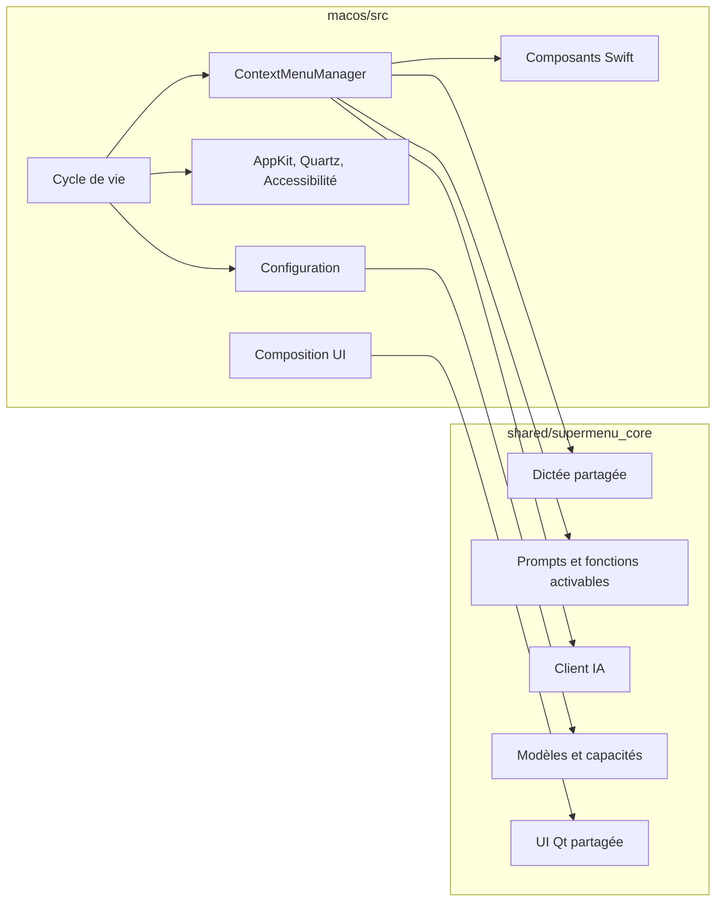
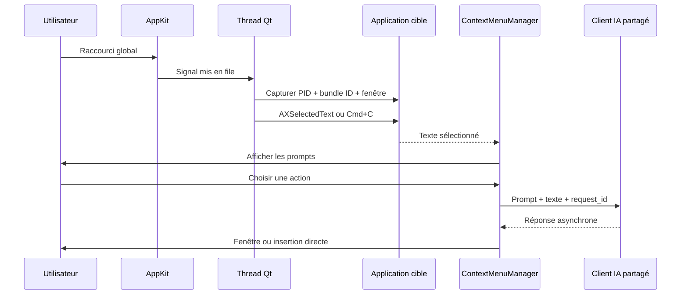

# Architecture technique de SuperMenu pour macOS

Ce document décrit la composition macOS, ses frontières avec le cœur partagé,
les flux AppKit et Qt, la sécurité de l’insertion et la chaîne de
distribution. Il s’adresse aux contributeurs ; l’utilisation est décrite dans
le [guide d’utilisation](GUIDE_UTILISATION.md).

## Principes directeurs

1. **Séparation des plateformes** : aucun import de `win32/`, aucune couche
   unique chargée de faire vivre deux systèmes.
2. **Métier partagé** : fournisseurs IA, modèles, prompts, validateurs et
   composants Qt génériques restent dans `shared/supermenu_core`.
3. **Boucle principale jamais bloquée** : les attentes passent par le
   scheduler Qt, jamais par un `sleep` sur le thread principal.
4. **Cible explicite** : toute lecture ou insertion est associée à une
   application capturée par PID et identifiant de bundle.

## Vue d’ensemble



Le cœur partagé ne connaît pas la plateforme. La couche macOS adapte ses
interfaces : réglages, présentation, insertion, accès aux fournisseurs et
moteurs vocaux.

## Arborescence

```text
macos/
├── src/
│   ├── main.py                     # cycle de vie et instance unique
│   ├── api/
│   │   ├── openai_client.py        # client partagé, en mode texte seul
│   │   └── apple_foundation_client.py  # Apple Foundation Models
│   ├── audio/speech_backend.py     # OpenAI ou Apple Speech
│   ├── config/
│   │   ├── build_info.py           # version et canal du package
│   │   └── settings.py             # QSettings, prompts, migrations
│   ├── ui/
│   │   ├── main_window.py          # configuration, mises à jour, autorisations
│   │   ├── status_item.py          # barre des menus AppKit (NSStatusItem)
│   │   ├── prompt_dialog.py        # dialogue partagé
│   │   └── response_window.py      # présentation et insertion macOS
│   └── utils/
│       ├── accessibility_text.py   # lecture AXSelectedText et fenêtre focalisée
│       ├── clipboard_manager.py    # snapshot, écritures temporaires, restauration
│       ├── context_menu.py         # sélection → IA → réponse, voix
│       ├── hotkey_manager.py       # moniteurs AppKit et enregistreur Qt
│       ├── key_events.py           # événements Copier/Coller Quartz
│       ├── logger.py               # journal et journal de crash natif
│       ├── paths.py                # dossiers de configuration et de journaux
│       ├── permissions.py          # autorisation Accessibilité
│       ├── selection.py            # lecture asynchrone de la sélection
│       ├── text_inserter.py        # collage asynchrone vérifié
│       ├── updater.py              # manifestes et choix du DMG
│       └── window_target.py        # identité et activation de la cible
├── native/
│   ├── FoundationModelsHelper.swift
│   └── SpeechHelper.swift
├── scripts/                        # composants natifs, DMG, notarisation
├── tests/
├── entitlements.plist
├── SuperMenu-macos.spec
└── run.py
```

## Frontière avec le cœur partagé

`shared/supermenu_core` possède :

- le client OpenAI et les endpoints compatibles, Ollama et LM Studio ;
- les capacités des modèles et les options de raisonnement ;
- les prompts textuels et vocaux, leur validation, leur réparation et leurs
  copies de sauvegarde ;
- les interrupteurs des fonctions avancées et expérimentales ;
- la capture microphone Qt, `DictationSession` et le service des modèles
  vocaux résidents ;
- le dialogue de prompt, la fenêtre de réponse de base, les pages de réglages,
  les thèmes, les indicateurs et les dialogues sûrs.

La composition macOS possède :

- le démarrage de `QApplication` et l’instance unique ;
- l’icône de la barre des menus ;
- les moniteurs clavier AppKit et l’autorisation Accessibilité ;
- la lecture AX et le repli presse-papiers ;
- l’activation et l’identité des applications ;
- l’émission des événements Quartz ;
- les composants Swift (Foundation Models, Apple Speech) ;
- la configuration, les journaux et le packaging.

Les adaptateurs restent minces : le client macOS désactive les images, le
dialogue de prompt réexporte le composant commun et la fenêtre de réponse
fournit `TextInserter` à sa base partagée.

## Fonctions avancées et expérimentales

Les deux interrupteurs vivent dans `supermenu_core.config.feature_modes`
(`FeatureModesSettingsMixin`, hérité par `Settings`). Règle : lire au moment
de l’usage, filtrer à l’enregistrement, ne jamais supprimer.

- `Settings.__init__` détecte une installation existante
  (`has_saved_preferences()`) avant d’écrire le moindre défaut : les
  interrupteurs sont créés activés pour une mise à jour, désactivés pour une
  nouvelle installation. `reset_to_defaults()` les conserve.
- `HotkeyManager.register_hotkey()` laisse la dictée instantanée non liée
  sans les fonctions expérimentales ; `PromptHotkeyManager.refresh_hotkeys()`
  lie une table vide et `validate_prompts()` accepte tout sans les fonctions
  avancées, pour qu’un raccourci masqué ne bloque jamais un enregistrement ou
  un import.
- `ContextMenuManager` ne construit le sous-menu **Voix** qu’avec les
  fonctions expérimentales et protège ses points d’entrée
  (`start_dictation`, `start_instant_dictation`, `_start_voice_session`,
  `run_voice_prompt`, `run_prompt_hotkey`), car un raccourci déjà mis en file
  peut arriver après la désactivation. `_send_request` applique
  `effective_model_target()`.
- `create_speech_backend()` transmet `effective_speech_idle_seconds()` au
  modèle vocal résident.
- `MainWindow._apply_feature_visibility()` masque, sans les retirer, l’onglet
  Voix, la rubrique Dictée, le groupe de dictée instantanée, les lignes de
  modèle et de raccourci des prompts, la mémoire du modèle vocal et l’entrée
  `DICTATION_MENU_ENTRY` de la barre des menus
  (`NativeStatusItem.set_entry_visible()`).
- `apply_feature_modes()`, relié à `FeatureModeSettings.modes_changed`,
  libère les raccourcis de prompts, réenregistre la dictée instantanée si
  besoin, puis lie de nouveau les prompts : la priorité reste celle du
  démarrage. À la désactivation des fonctions expérimentales, il arrête la
  vérification vocale et le test du micro, et décharge le modèle vocal
  inactif.

## Amorçage et cycle de vie

`run.py` propose l’exécution normale et `--smoke-test`. Le smoke test vérifie
les ressources packagées, la version et le canal, les modules de dictée, les
API d’autorisation et les callbacks PyObjC des moniteurs natifs.

`src/main.py` :

1. installe la journalisation des exceptions et le journal de crash natif
   (`faulthandler`) ;
2. crée `QApplication` avec `setQuitOnLastWindowClosed(False)` ;
3. garantit une instance unique avec `QLocalServer` / `QLocalSocket` ;
4. construit les réglages, l’orchestrateur et le service de raccourcis ;
5. connecte les signaux natifs aux slots Qt ;
6. crée la fenêtre principale et applique le thème ;
7. installe l’icône de la barre des menus, puis affiche les autorisations si
   Accessibilité manque ou si un raccourci enregistré est refusé ; sinon,
   l’application reste dans la barre des menus ;
8. lance la vérification des mises à jour si elle n’a pas encore eu lieu ce
   jour-là.

Une seconde instance signale l’instance existante, qui présente sa fenêtre,
puis se termine. À la fermeture, les moniteurs, clients, requêtes et
fenêtres sont fermés explicitement.

### Barre des menus

`src/ui/status_item.py` crée un `NSStatusItem` AppKit (`NativeStatusItem`)
dont les entrées sont décrites une seule fois par
`MainWindow._status_menu_entries()`. Ce choix évite le chemin Qt Cocoa de
`QSystemTrayIcon`, qui lit `NSEvent.clickCount` sur un événement non souris
et plante sous macOS 27. Si AppKit échoue, la fenêtre de configuration
s’ouvre à la place.

### Workers d’arrière-plan

`UpdateCheckWorker` et `CustomModelsWorker` héritent de `_BackgroundWorker` :
un `QObject` dont `run()` s’exécute dans un `threading.Thread` démon et dont
les signaux arrivent sur le thread Qt. Quitter pendant une requête bloquée ne
provoque plus d’arrêt brutal.

## Raccourcis globaux

### Normalisation et validation

`normalize_hotkey()` transforme `Command`, `Control`, `Option`, etc. vers une
forme canonique. La validation exige un modificateur et refuse :

- toute combinaison `Cmd` + `Q` ;
- `Cmd+H`, `Cmd+M`, `Cmd+W` (gestion des fenêtres) et `Cmd+Space`
  (Spotlight) ;
- `Cmd+A`, `Cmd+C`, `Cmd+V`, `Cmd+X` et `Cmd+Z` : SuperMenu envoie lui-même
  `Cmd+C` et `Cmd+V`, qui déclencheraient le raccourci ;
- une touche autre que `F1` à `F24` sans `Cmd` ni `Ctrl` : les moniteurs
  `NSEvent` observent la frappe sans la consommer, et `Shift+K` se
  déclencherait à chaque K majuscule.

Un raccourci déjà enregistré par une version précédente est relu avec
`legacy=True` (`_normalize_stored_hotkey`) : il reste lié, et le journal
conseille de le remplacer. `validate_prompts()` n’applique la règle actuelle
qu’aux raccourcis modifiés, pour qu’un ancien raccourci ne bloque pas
l’enregistrement d’un autre prompt. Un doublon entre prompts lève une erreur
qui nomme les deux prompts, au lieu d’effacer l’un d’eux.

L’enregistreur est un dialogue Qt. `_modifier_labels()` traduit les
modificateurs Qt vers les touches physiques macOS, pour afficher Command et
Control correctement. La touche est lue dans `QKeyEvent.key()`, comme le
détecteur lit `charactersIgnoringModifiers`, et non dans `text()`, qui
renvoie le caractère composé (`Option+K` donne `˚`).

### Moniteurs AppKit persistants

`_MacOSGlobalHotKeys` installe deux moniteurs `NSEvent` :

- global pour les événements destinés aux autres applications ;
- local lorsque SuperMenu est actif.

Ils restent en place pendant toute la vie de l’application. Modifier un
raccourci remplace seulement la table des liaisons, sous verrou. Seul un
raccourci reconnu est journalisé, sous sa forme normalisée : aucune touche
observée n’est écrite dans le journal.

`HotkeyService` fusionne quatre propriétaires : menu principal, mode
personnalisé, dictée instantanée et raccourcis des prompts. Une combinaison
n’appartient qu’à un propriétaire. Le service est suspendu pendant
l’enregistrement d’un raccourci, pour ne pas déclencher une ancienne action.

Le callback AppKit ne lance jamais le menu directement : il émet un signal
remis en file vers le thread Qt, ce qui évite la réentrance dans le
gestionnaire `NSEvent`.

## Capture et activation de la cible

`PasteTarget` représente l’application externe par son PID, son identifiant de
bundle et son nom. Le PID seul ne suffit pas, car il peut être réutilisé après
la fermeture d’une application : l’identifiant de bundle est revérifié avant
chaque réactivation.

`PasteTarget.focused_window` garde en plus l’élément Accessibilité de la
fenêtre active au moment de la capture (`AXFocusedWindow`). Il ne fait pas
partie de l’identité et reste `None` si Accessibilité ne répond pas.
`focused_window_matches()` ne renvoie `False` que si une autre fenêtre de la
même application a le focus ; toute réponse inconnue garde la vérification au
seul niveau de l’application.

La dernière cible externe est mémorisée juste avant que la fenêtre de
configuration ou la barre des menus active SuperMenu : une action lancée
depuis l’interface peut ainsi revenir vers l’application que l’utilisateur
venait de quitter.

L’activation préfère les API coopératives modernes. Le chemin historique
`NSApplicationActivateIgnoringOtherApps` ne sert qu’en compatibilité, si macOS
n’honore pas la première demande. Les vérifications de focus sont planifiées :
dormir sur le thread Qt empêcherait `NSWorkspace` et `NSRunningApplication` de
rafraîchir leurs propriétés.

## Lecture de la sélection

`SelectionReader` utilise deux chemins ordonnés.

### Chemin Accessibilité

Pris seulement si la cible est l’application active (`target.is_current()`).
`AccessibilitySelectionReader` demande l’élément focalisé puis
`kAXSelectedText`. Une réponse non vide termine la lecture sans événement
clavier ni modification du presse-papiers. Un élément qui appartient à
SuperMenu lui-même (`AXUIElementGetPid`) est ignoré et la lecture passe au
presse-papiers. `limit_messaging_timeout()` borne chaque échange AX
(`AX_MESSAGING_TIMEOUT_S`, 1 s) : une application figée renvoie une erreur au
lieu de geler la boucle Qt.

Cette API n’est pas universelle : certaines applications Electron, Java ou
vues personnalisées n’exposent rien d’exploitable.

### Repli presse-papiers

1. la cible est validée et réactivée ;
2. le presse-papiers est capturé (tous ses formats) ;
3. une sentinelle unique y est écrite ;
4. SuperMenu attend le relâchement des modificateurs ;
5. `Cmd+C` est émis avec Quartz ;
6. le presse-papiers est interrogé à courts intervalles ;
7. la sélection est livrée ;
8. l’ancien contenu est restauré seulement si personne d’autre ne l’a modifié.

La sentinelle distingue une absence de sélection d’un ancien texte resté dans
le presse-papiers. `ClipboardManager.set_clipboard_text_safe`, utilisé pour la
sentinelle et pour la réponse à coller, écrit via `NSPasteboard` avec
`NSPasteboardContentsCurrentHostOnly` et les marqueurs
`org.nspasteboard.TransientType`, `ConcealedType` et `AutoGeneratedType` : les
gestionnaires d’historique ignorent ces valeurs et le presse-papiers universel
ne les propage pas. L’écriture native n’est gardée que si Qt relit exactement
le même texte ; sinon, `QClipboard.setText` prend le relais.

## Événements Copier/Coller

`KeyEventPoster` utilise CoreGraphics plutôt qu’une résolution de caractères :

- les codes de touche `C` et `V` sont positionnels et fonctionnent avec les
  dispositions non latines ;
- `CGEventSetFlags` assigne explicitement Command sans fusionner les touches
  que l’utilisateur tient encore ;
- Command reçoit ses propres événements down/up et ne reste pas « collée » ;
- l’intervalle de suppression locale est nul, pour ne pas bloquer la souris.

L’attente du relâchement des modificateurs est bornée et planifiée par Qt.

## Flux menu → IA → réponse



`ContextMenuManager` empêche deux menus ou lectures de sélection de se
chevaucher. Il suit les requêtes par `request_id` et garde un ancien client IA
en vie jusqu’à la fin de ses requêtes quand un réglage change ;
`update_client_config()` vide aussi le cache partagé des capacités des
modèles. Un prompt qui choisit son propre modèle reçoit un client dédié.

Un prompt normal prépare la fenêtre de réponse avant l’appel réseau. Pour un
prompt à insertion directe, `cleanup_menu` rend aussitôt le premier plan à la
cible pendant l’appel IA, et un indicateur reste visible près du curseur. Une
erreur de requête appelle `set_error` : statut d’échec, insertion désactivée.
L’erreur d’une requête directe s’affiche dans une boîte `SafeDialogs` dont la
fermeture (`on_closed`) réactive la cible ; l’échec tardif d’une requête non
directe remplacée par une plus récente est seulement journalisé.

## Insertion vérifiée

`TextInserter.insert_text_async()` suit cette séquence :

1. validation de la cible ;
2. activation coopérative ;
3. vérification différée ;
4. activation forcée de compatibilité si nécessaire ;
5. snapshot puis écriture temporaire du presse-papiers ;
6. attente du relâchement des modificateurs ;
7. dernière vérification de la cible : application (`is_current()`), puis
   fenêtre (`focused_window_matches()`) ;
8. émission de `Cmd+V` ;
9. restauration conditionnelle du presse-papiers.

Une cible différente provoque une annulation explicite au lieu d’un collage
au mauvais endroit : `target_changed` pour une autre application,
`window_changed` pour une autre fenêtre ou un autre document de la même
application. En insertion directe, `_keep_refused_direct_response` affiche
alors la réponse dans la fenêtre de réponse, avec le prompt, le contenu, le
modèle et le raisonnement d’origine (**Réessayer** fonctionne), ou la copie
dans le presse-papiers si cette fenêtre attend encore une autre requête.

## Fournisseur Apple Foundation Models

`src/api/apple_foundation_client.py` implémente les mêmes signaux de requête
que le client HTTP. `ContextMenuManager` le choisit quand `ai_provider` vaut
`apple`. Les anciennes configurations sont migrées à partir de
`use_custom_endpoint` au premier choix d’un fournisseur.

Chaque demande lance `native/FoundationModelsHelper.swift`, compilé en
exécutable arm64 et embarqué dans le bundle. Le protocole envoie un objet JSON
sur stdin et lit un objet JSON sur stdout : le texte n’apparaît ni dans la
ligne de commande, ni sur disque, ni dans les journaux. Les erreurs natives
deviennent des codes stables et des messages en français ; un composant
absent demande de réinstaller SuperMenu. Ce client n’envoie aucune requête
réseau et ne bascule jamais vers un autre fournisseur.

`QProcess` garde l’interface réactive : une vérification de disponibilité a
un délai de 15 secondes, une génération de 120 secondes. Fermer l’application
tue les processus encore actifs. Chaque génération crée une nouvelle session
Apple, pour éviter l’accumulation de contexte. Un dépassement de contexte est
signalé sans tronquer silencieusement la sélection.

## Dictée

La capture microphone Qt, `DictationSession`, `PlainDictationSession` et la
fenêtre de transcription viennent du cœur partagé. `src/audio/speech_backend.py`
choisit OpenAI ou Apple Speech, via `native/SpeechHelper.swift` (macOS 26 ou
plus récent). L’autorisation Microphone est demandée avant la capture.

Le service partagé des modèles résidents garde le processus Apple Speech entre
les dictées, avec une nouvelle session de transcription pour chacune, et le
décharge après le délai choisi (cinq minutes par défaut). Le composant Apple
utilise la
[conservation du modèle pendant la durée du processus](https://developer.apple.com/documentation/speech/speechanalyzer/options/modelretention-swift.enum/processlifetime).
Le microphone est arrêté entre les dictées et aucun audio n’est sauvegardé.

L’éditeur de prompts vocaux, le menu vocal, la persistance et l’assemblage de
l’instruction avec la transcription et la sélection sont partagés avec
Windows. `VoicePromptEditor` émet l’identifiant du prompt ;
`ContextMenuManager` capture la cible et lit la sélection avec les services
macOS avant de lancer la session. Seul le résultat final déclenche une
requête vers le moteur de texte. La correction d’une dictée simple lit, au
moment de l’insertion, le mode de raisonnement du prompt « Corriger ». Une
annulation ignore les résultats tardifs.

## Configuration, secrets et journaux

`Settings` utilise `QSettings` au format INI :

```text
~/Library/Application Support/SuperMenu/SuperMenu.ini
```

Le fichier est remis en `0600` après chaque écriture et contient endpoints,
clés, modèles, raisonnement, raccourcis, prompts, thème et canal de mise à
jour. Les prompts passent par le schéma partagé : en lecture,
`repair_prompt_collection` répare ou écarte une entrée invalide sans effacer
les autres et copie la valeur brute dans `prompts_backups` ; en écriture,
`set_prompts` valide strictement et lève `ValueError` au lieu d’écrire une
collection vide.

La composition macOS n’utilise pas le Trousseau. Ce choix évite les demandes
répétées des anciens builds non signés, au prix d’un secret protégé par le
compte utilisateur plutôt que par Keychain.

Les journaux sont écrits dans :

```text
~/Library/Logs/SuperMenu/supermenu.log
~/Library/Logs/SuperMenu/native-crash.log
```

Ils décrivent les phases et les erreurs sans secret, sélection, prompt ni
touche observée. Les variables `SUPERMENU_CONFIG_DIR` et `SUPERMENU_LOG_DIR`
remplacent ces dossiers, par exemple pour les tests.

## Autorisation Accessibilité

`permissions.py` charge `AXIsProcessTrusted` pour lire l’état et
`AXIsProcessTrustedWithOptions`, via HIServices, pour déclencher le dialogue
natif. La lecture de l’état n’affiche jamais de dialogue.

L’interface n’ouvre les Réglages Système qu’après la demande native, pour
éviter deux fenêtres concurrentes. L’état est interrogé toutes les 1,5 s
pendant que la fenêtre de configuration est visible, et aussi fenêtre fermée
tant qu’une autorisation est attendue : les moniteurs sont recréés dès que
macOS l’accorde, puis l’interrogation s’arrête. macOS crée les moniteurs
`NSEvent` même sans autorisation, mais ils ne reçoivent alors aucune touche :
le statut « Raccourcis globaux actifs » exige donc l’autorisation, ou un état
illisible signalé comme tel.

## Updater macOS

| Canal | Manifeste | Asset |
|---|---|---|
| Stable | `update-macos-stable.json` | `SuperMenu-macOS-arm64.dmg` |
| Bêta | `update-macos-beta.json` | `SuperMenu_Beta-macOS-arm64.dmg` |

Le manifeste (version de schéma 1) valide la plateforme `macos`,
l’architecture `arm64`, le canal, le statut de prérelease, la version, le
tag, le nom exact du DMG et le format de son empreinte `sha256`.

Le manifeste est lu avant l’API REST GitHub. En secours, l’API est interrogée,
mais la recherche exige toujours le nom exact du DMG ; la version macOS est
lue dans la ligne `macOS version:` du texte de la release, jamais dans la
version Windows. L’application ouvre le téléchargement ; elle ne se remplace
pas pendant son exécution.

## Packaging et notarisation

`SuperMenu-macos.spec` produit un bundle PyInstaller `arm64` avec
l’identifiant `com.supermenu.macos`, `LSMinimumSystemVersion` 13.0 (version
minimale des roues PySide6 6.11), la description d’usage du microphone, le
Hardened Runtime et `entitlements.plist`. `LICENSE`, `THIRD_PARTY_NOTICES.md`,
`licenses/` et `third_party_licenses/` sont copiés dans `Contents/Resources`.
Qt Virtual Keyboard (GPL-3.0 ou licence commerciale) et Qt Pdf, collectés par
les hooks Qt mais jamais utilisés, sont retirés du bundle.

Les entitlements autorisent les mécanismes dynamiques requis par
PyObjC/libffi : sans eux, le runtime durci tue le processus à la création des
callbacks Objective-C des moniteurs globaux. Leur justification est détaillée
dans [SIGNING.md](../SIGNING.md).

`scripts/build_dmg.sh` :

1. génère l’icône et compile les composants Swift
   (`build_foundation_helper.sh`, `build_speech_helper.sh`) ;
2. exécute PyInstaller ;
3. vérifie strictement la signature si une identité est fournie ;
4. lance le smoke test du bundle ;
5. vérifie la présence de `LICENSE`, `THIRD_PARTY_NOTICES.md` et
   `licenses/LGPL-3.0.txt` dans l’application ;
6. interroge les deux composants Swift embarqués avec
   `scripts/check_native_helper.py` ;
7. notarie et agrafe `SuperMenu.app` si les secrets sont présents ;
8. copie le bundle avec `ditto` dans un volume avec un lien vers
   Applications ;
9. crée le DMG (trois tentatives au plus) et le signe.

Le `.app` est notarié avant d’entrer dans le DMG, car le ticket du volume ne
suit pas l’application une fois déplacée. `notarize_dmg.sh` soumet ensuite le
volume, agrafe son ticket et le valide.

Les composants Swift sont compilés avec Xcode 26.2 pour une cible macOS 12 ;
le framework est lié faiblement et ses appels sont protégés par une
vérification de macOS 26. Sur les runners macOS 15, ils ne peuvent répondre
que « système non pris en charge », ce que `check_native_helper.py` accepte
seulement sur un système antérieur à macOS 26.

## CI et releases

- **CI** (`ci.yml`) : le cœur et Windows sous Python 3.11 et 3.12, le cœur et
  macOS sous Python 3.12 (compilation, pytest, lint critique, smoke test),
  puis construction d’un DMG de contrôle sur macOS 15. Une configuration Apple
  partielle échoue explicitement.
- **Composants natifs** (`native-helpers.yml`) : contrôle informatif des
  composants Swift sur un runner macOS 26, à chaque modification, chaque
  semaine ou à la demande ; il ne bloque rien.
- **Bêta** (`beta-release.yml`) : après une CI réussie d’un push sur `main` du
  dépôt, Windows et macOS sont construits en parallèle. La publication attend
  les deux plateformes et contient les exécutables Windows, le DMG signé et
  notarié, les manifestes et les empreintes SHA-256.
- **Stable** (`stable-release.yml`) : un tag `vMAJOR.MINOR.PATCH` égal à
  `win32/VERSION` déclenche la release. Elle est publiée une seule fois,
  jamais réécrite par le workflow. `macos/VERSION` est indépendant et figure
  dans le manifeste macOS.

Les tests s’exécutent avant l’injection des métadonnées de packaging dans
`build_info.py` : ils ne confondent jamais la version du dépôt avec une
version Bêta générée. La procédure complète est décrite dans
[docs/RELEASING.md](../../docs/RELEASING.md).

## Stratégie de tests

Des frontières injectables autour d’AppKit, Quartz, HIServices, du
presse-papiers et du scheduler permettent de vérifier, y compris hors macOS :

- normalisation, conflits et règles des raccourcis ;
- cycle de vie des moniteurs global et local ;
- événements Command cohérents et relâchement en cas d’erreur ;
- lecture AX et repli presse-papiers ;
- restauration conditionnelle ;
- activation coopérative puis forcée ;
- annulation lors d’un changement d’application ou de fenêtre ;
- autorisations et comportement de l’interface ;
- choix strict des DMG et validation des manifestes ;
- entitlements, licences embarquées et scripts de notarisation.

Les modules qui ont un équivalent Windows se terminent par `_mac.py`.
`test_prompt_model_routing_mac.py` et `test_prompt_model_routing_win.py` sont
volontairement identiques et doivent le rester. `conftest.py` exécute les
tests comme une installation mise à jour (les deux interrupteurs actifs) et
détruit après chaque test les objets Qt en attente de `deleteLater()` : un
test qui crée une fenêtre de configuration doit la fermer et appeler
`deleteLater()`.

Le smoke test du binaire signé installe réellement les blocs PyObjC. Il
détecte les erreurs de Hardened Runtime, qui provoqueraient un crash natif
plutôt qu’une exception Python.

## Règles d’évolution

- Le métier commun va dans `shared/supermenu_core`.
- AppKit, Quartz et les autorisations restent dans `macos/src`.
- Une attente de focus ou de presse-papiers est asynchrone et bornée.
- Toute insertion conserve et revalide une `PasteTarget`.
- Une fonction soumise à un interrupteur est vérifiée au moment de l’usage et
  ne supprime jamais de réglage.
- Le packaging conserve le smoke test, la signature stricte et l’agrafage du
  `.app`.
- Un nouvel asset a un nom déterministe, une entrée de manifeste et une
  empreinte SHA-256.

Retour au [README macOS](../README.md) ou au
[README principal](../../README.md).
